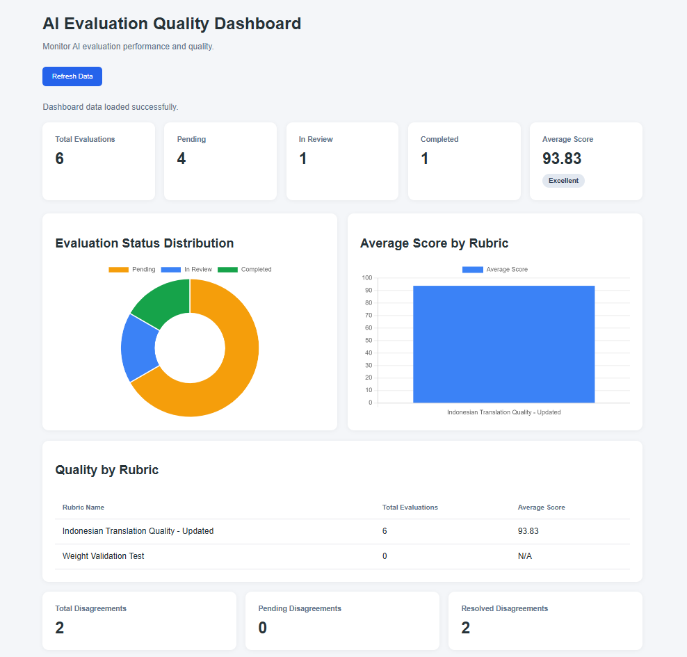
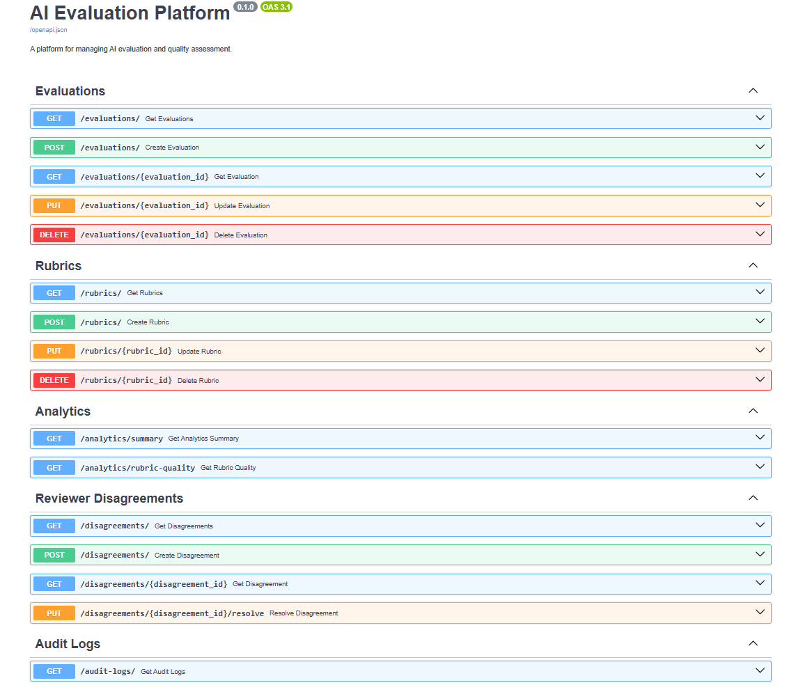
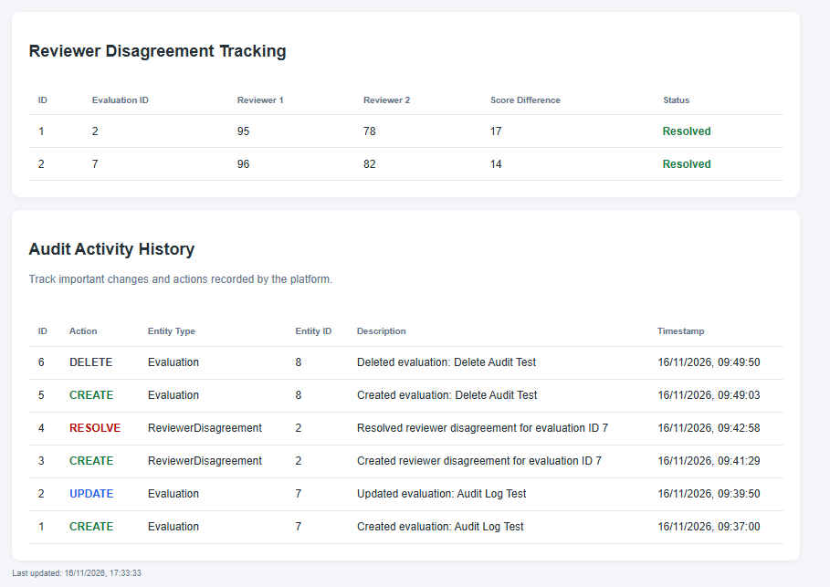

# AI Evaluation & Quality Management Platform

A web-based application designed to help manage, track, and monitor AI model evaluation activities and quality assessment workflows.

## Project Overview

The AI Evaluation & Quality Management Platform provides a structured environment for recording AI model evaluations, managing evaluation rubrics, tracking reviewer disagreements, and monitoring evaluation quality through an interactive dashboard.

The platform focuses on supporting human-led AI evaluation and quality monitoring processes.

## Key Features

### 1. Evaluation Management
- Create, view, update, and delete evaluation records.
- Store prompts and AI model responses.
- Record evaluation scores and reviewer notes.
- Track evaluation status.

### 2. Rubric Management
- Create and manage evaluation rubrics.
- Define evaluation criteria.
- Assign weights to individual criteria.
- Validate that criterion weights total 100%.

### 3. Reviewer Workflow
- Track evaluation status:
  - Pending
  - In Review
  - Completed

### 4. Reviewer Disagreement Tracking
- Record scores from two reviewers.
- Track score differences.
- Track disagreement resolution status.
- Store resolution notes.

### 5. Analytics Dashboard
- Monitor total evaluations.
- View evaluation status distribution.
- Track average evaluation scores.
- Compare quality scores across rubrics.
- Display reviewer disagreement statistics.

### 6. Audit Logs
- Record important system activities.
- Track CREATE, UPDATE, RESOLVE, and DELETE actions implemented in the application.
- Store activity descriptions and timestamps.
- Display audit history through the dashboard.

## Technology Stack

- Python
- FastAPI
- SQLAlchemy
- SQLite
- Pydantic
- HTML
- CSS
- JavaScript
- Chart.js

## Project Structure

```text
ai-evaluation-platform/
│
├── app/
│   ├── api/
│   │   └── routes/
│   │       ├── analytics.py
│   │       ├── audit.py
│   │       ├── disagreements.py
│   │       ├── evaluations.py
│   │       └── rubrics.py
│   │
│   ├── database/
│   │   ├── connection.py
│   │   ├── init_db.py
│   │   └── models.py
│   │
│   ├── schemas/
│   │   ├── disagreement.py
│   │   ├── evaluation.py
│   │   └── rubric.py
│   │
│   ├── services/
│   │   └── audit.py
│   │
│   ├── static/
│   │   └── dashboard.html
│   │
│   └── main.py
│
├── .gitignore
├── requirements.txt
└── README.md
```

The SQLite database is created locally when the application is initialized and is excluded from the Git repository.

## Installation and Setup

### 1. Clone the repository

```bash
git clone https://github.com/therobotic-dev/ai-evaluation-platform.git
cd ai-evaluation-platform
```

### 2. Create a virtual environment

```bash
python -m venv .venv
```

### 3. Activate the virtual environment

Windows PowerShell:

```powershell
.\.venv\Scripts\Activate.ps1
```

### 4. Install dependencies

```bash
pip install -r requirements.txt
```

### 5. Initialize the database

```bash
python -m app.database.init_db
```

### 6. Run the application

```bash
uvicorn app.main:app --reload
```

## Access the Application

Dashboard:

```text
http://127.0.0.1:8000/dashboard
```

API Documentation:

```text
http://127.0.0.1:8000/docs
```

## Testing

The following application workflows have been manually tested through the FastAPI interactive API documentation:

- Evaluation CRUD operations.
- Rubric creation and validation.
- Evaluation status updates.
- Reviewer disagreement creation and resolution.
- Analytics API responses.
- Dashboard data visualization.
- Audit log recording for CREATE, UPDATE, RESOLVE, and DELETE operations.

## Project Purpose

This project demonstrates the implementation of a structured AI evaluation management workflow, with an emphasis on evaluation consistency, rubric-based assessment, reviewer alignment, quality monitoring, and activity traceability.

## Screenshots

### Main Dashboard


### API Documentation


### Reviewer Disagreement and Audit Logs


### Full Dashboard
[View Full Dashboard Screenshot](screenshots/04-full-dashboard.png)